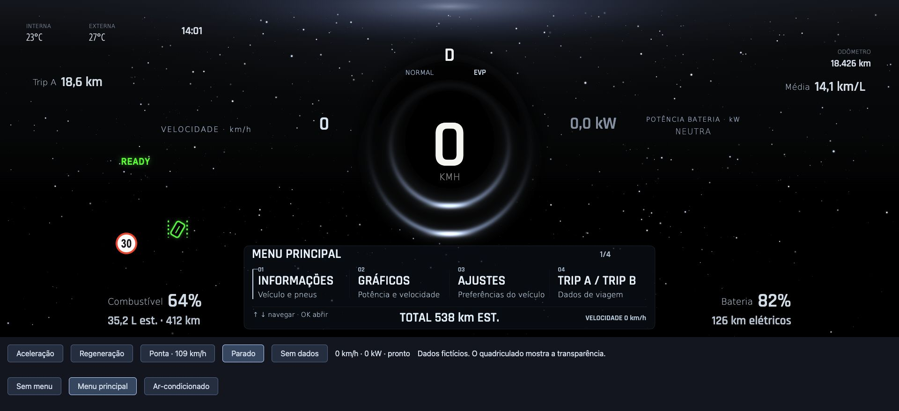
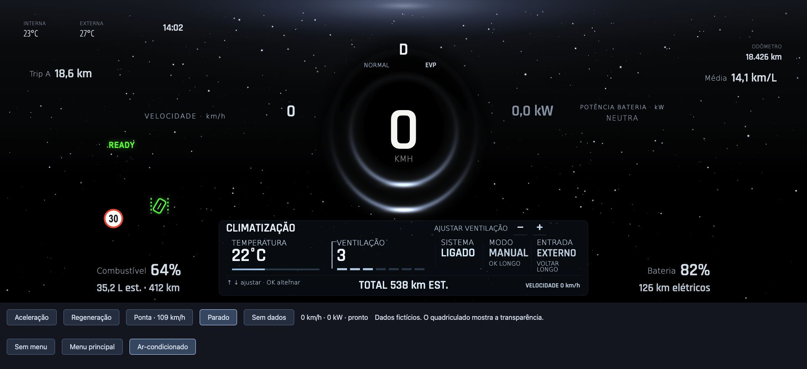

# Starlight 1.0.8 para preview — 2026-10-14

Continuação do estudo do PR #161, já integrado. Publica o tema instalável nas pastas
`cluster-widgets/source/v1.0/Starlight/` e `cluster-widgets/Themes/v1.0/Starlight/`.

## Resultado

- Telemetria real do contrato v1.0 e bridge mínima 1.0.1; pacote HTML offline, fontes e licenças.
- Material em dois workers Canvas2D com fallback e fila limitada; culling reduz cálculos fora das barras.
- Leitura de velocidade/kW junto à ponta visível, acompanhando o último desenho confirmado da barra.
- Céu até o rodapé e remoção da linha clara superior; contorno preto nas leituras inferiores.
- My Menu e climatização com texto maior e fundo discreto somente quando abertos.
- Área 1920×720 preservada; avisos ocultam o tema, projeção preserva transparência e AC sem superfície.
- Theme Lab registra a versão instalável separadamente do estudo original, mantendo mocks fora do OTA.

A cobertura central ADAS no modo normal foi autorizada expressamente pelo proprietário em
2026-10-11. É uma exceção visual, sem garantia de composição OEM ou fluidez física. Não há
alterações no Android, bridge nativa, patches, serviços ou resoluções nesta entrega.

## Validação desta publicação

- `npm ci`, `npm run thumbnail`, `npm run build`, `npm run check` no tema: PASS.
- Menus: 37 cenários / 74 composições, 1.234 glifos, mínimo 14 px, sem sobreposição ou overflow.
- Runtime: 31 checks; pipeline: 18 checks; renderer e pacote offline: PASS.
- `npm run check` e `npm run build` em `cluster-widgets`: PASS.
- `npm ci` e `npm test` no estudo original: PASS, incluindo a separação do catálogo.
- `./gradlew :app:testDebugUnitTest :app:assembleDebug :app:lintDebug`: PASS.
- Testes JVM: 563, zero falhas/erros/skips. Lint: zero erros, 321 warnings da base.
- Navegador: pacote e menus no canvas 1920×720; seleção Starlight1.0.8 e telemetria no Theme Lab.
  Console do Starlight sem erros/warnings. O carregamento inicial do Default sinalizou dependência
  chart.js ausente no checkout novo; a seleção/reload do Starlight funcionou sem alteração no Default.
- `git diff --check`: PASS após build e staging.

O HTML final tem 1.529.441 bytes e SHA-256
`e9a30082a18cd07da6c84616bf492d85409cb76a42979ba07e4fc436bee32095`.
As comparações com backups locais de versões anteriores são opcionais nos scripts e não estão
presentes em um checkout limpo; os checks autossuficientes de bounds/alpha/dados continuam ativos.

## Prévias locais

Dados fictícios; estas imagens não comprovam composição física na central.

## Limites e próximos passos

A última instalação comprovada nesta conversa foi a 1.0.7 em 2026-10-13. A publicação da 1.0.8
não instala nem reinicia a central. Aceite visual físico, prioridade OEM e performance em movimento
continuam a confirmar. A fila do worker ainda não tem timeout por frame; erro explícito usa fallback.

A branch de PR parte de upstream/preview 2d4e32e6be039d6e741c5f764bf72ab34b92ede4.
O checkout principal permaneceu na branch original, com seu WIP preservado e backup local antes
da criação do worktree. Não foram incluídas mudanças de Obsidian, Sport ou Android nesse PR.
